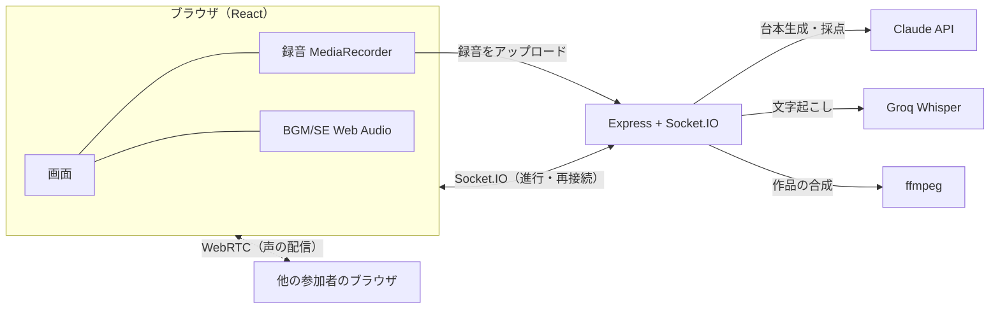

# こじらせ大劇場 〜大根役者選手権〜


**AIが台本を書き、AIが演技を採点する。声だけで一幕を演じきるパーティーゲーム。**

▶ **遊ぶ：https://kojirase-daigekijo-production.up.railway.app**
（ログイン不要・スマホ / PC のブラウザで動きます）

---

## どんなゲーム？

1. ホストがルームを作り、4文字のルームコードで仲間を呼ぶ（1〜10人。1人なら一人芝居）
2. ジャンル（恋愛・ホラー・時代劇・SF・カオス など8種）を選ぶと、**AIが人数分の役と台本を書く**
3. 全員で台本を読み込み、**一発録り（ワンテイク）で同時に演じる**。BGM・効果音も鳴らせる
4. **AIが録音を文字起こしして台本と照合し、演技力・感情・こじらせ度を☆5段階で採点**。コメントと称号も付く
5. 全員の声とBGM・効果音を合わせた「作品」を聞き返し、結果を X に投稿できる

## 見どころ

- **全員同時のワンテイク録音** — サーバーとの時刻差を測って各端末の録音開始をそろえ、端末ごとの録音を1つの演技として扱う
- **1台で何人でも遊べる** — 携帯を回して全員が1台で演じても、1台に数人＋別の端末が混ざっても同じ操作で成立する。1本の録音のどのセリフが誰のものかは、AIが台本と照合して振り分ける
- **離れた相手の声をその場で聞ける** — 録音中は WebRTC で各端末の声をリアルタイムに配信（つながらない相手がいても録音・採点は止まらない設計）
- **「作品」の自動合成** — 全員の録音と、演技中に鳴らした BGM・効果音のタイムラインを、サーバーの ffmpeg で1本の m4a に合成する
- **切断に強い** — 通信が切れても、再接続トークンで同じ部屋の同じ役に戻れる。戻らない人はホストが外せる
- **公開しても破綻しない** — 1日にAIを使えるゲーム数の上限とレート制限を設け、AIが使えないときも手書き台本25本とスタブ採点の「簡易モード」で最後まで遊べる
- **昭和レトロな芝居小屋のUI** — 和紙・墨・朱の配色と立て看板風のタイトル画面

## 技術構成

| 領域 | 使ったもの |
|---|---|
| フロントエンド | React 18 / TypeScript / Vite / Tailwind CSS / Web Audio API / MediaRecorder / WebRTC |
| リアルタイム通信 | Socket.IO（ルーム・進行・再接続・WebRTC のシグナリング） |
| バックエンド | Node.js / Express / TypeScript（tsx で実行） |
| AI | Claude Haiku 5.5（台本生成・採点、構造化出力）／ Whisper large-v3-turbo on Groq（文字起こし） |
| 音声合成 | ffmpeg（ffmpeg-static） |
| テスト | node:test（サーバーは Socket.IO クライアントでつなぐ統合テスト中心） |
| デプロイ | Railway（Express が画面も配信する同一オリジン構成・単一インスタンス） |



## ディレクトリ構成

```
client/    画面（React）。client/public/audio に BGM・効果音
server/    ゲーム進行・AI 呼び出し・録音の受け取り・作品の合成
shared/    画面とサーバーで共有する型・定数・クレジット
prompts/   AI への指示文（台本生成・採点・ジャンルごとの作風）
plays/     AI が使えないとき用の手書き台本
docs/superpowers/  機能ごとの設計書（specs）と実装計画（plans）
doc/       全体仕様書
```

## ローカルで動かす

Node.js 20 以上が必要です。

```bash
npm --prefix server install
npm --prefix client install

# リポジトリ直下に .env を作る（.env.example を参照）
# ANTHROPIC_API_KEY / GROQ_API_KEY が無くても「簡易モード」で最後まで遊べます

# サーバー（http://localhost:3001）
npm --prefix server run dev
# 画面（http://localhost:5173）※別のターミナルで
npm --prefix client run dev
```

`.env` の `NODE_ENV` は空のままにしてください。`production` にするとサーバーが別ポートからの接続を受け付けなくなり、5173 番の画面から遊べません。

テストは `server/` と `client/` それぞれで `npm test`、型チェックは `npx tsc --noEmit` です。

## 開発の進め方

機能ごとに「設計書 → 実装計画 → テスト先行の実装 → レビュー」の順で進めています。
設計の判断や見送った案は [docs/superpowers/specs](docs/superpowers/specs) に、作業の手順は [docs/superpowers/plans](docs/superpowers/plans) に残しています。

開発は AI コーディングアシスタント（Claude Code）との協働で行いました。
企画・仕様の決定・設計案の採否・実機での確認は自分が担い、コードとテストの実装、設計書の下書きは AI に任せています。

## クレジット

- **BGM・効果音**：[OtoLogic](https://otologic.jp)（[CC BY 4.0](https://creativecommons.org/licenses/by/4.0/deed.ja)）※ループ化・音量調整などの加工をしています
- **笑い声**："Small Crowd Laughing" by snakebarney（[freesound](https://freesound.org/people/snakebarney/sounds/138112/) / CC0）
- **フォント**：Kaisei Decol（SIL Open Font License）
- 音源ごとの出典は [client/public/audio/README.md](client/public/audio/README.md) にまとめています

## ライセンス

ソースコードにはライセンスを設定していません（All rights reserved）。閲覧は自由ですが、流用・再配布はご遠慮ください。
音源は上記の各配布元のライセンスに従います。
